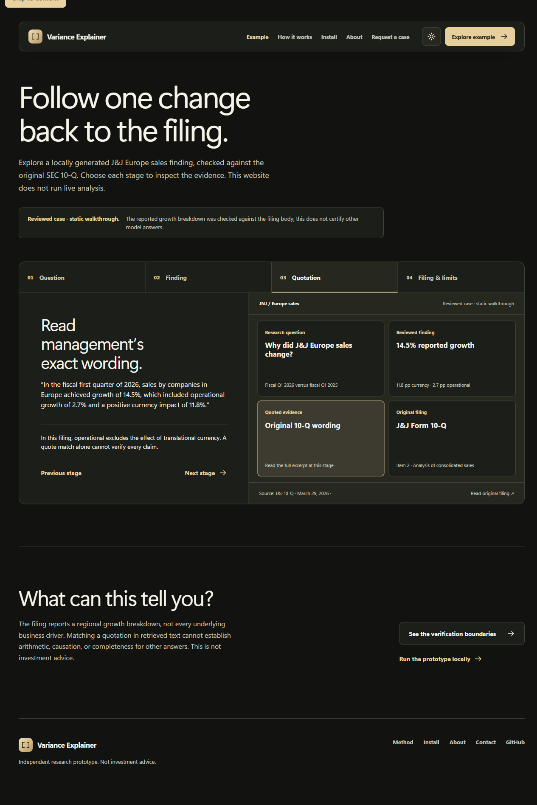

# Portfolio demo

**Public URL:** [rag-variance-explainer.vercel.app](https://rag-variance-explainer.vercel.app/) · [Explore the J&J case](https://rag-variance-explainer.vercel.app/example). The production case page was opened in a browser after commit `b07d77e`; it showed the approved 14.5% growth finding. This is a static walkthrough, not a live question-answering demo.

**Host:** The repository is already connected to Vercel; pushing `b07d77e` triggered its deployment. The Next.js `landing` exports static pages. No API key, Streamlit deployment, index upload, or model server is needed. Vercel Hobby is free for personal non-commercial use; if the site later becomes commercial, revisit the hosting terms before using this plan.

## What visitors can do

Explore the interactive static [J&J Europe sales case](landing/pages/example.js): question → reviewed finding → exact filing quotation → original [SEC Form 10-Q](https://www.sec.gov/Archives/edgar/data/200406/000020040626000087/jnj-20260329.htm) → limits. The case concerns fiscal Q1 2026 versus fiscal Q1 2025. The finding and wording were checked against Item 2 of the filing and approved by the owner; see the [review workpaper](docs/jnj-europe-sales-review-2026-11-11.md). This is one curated example, not a general model accuracy test.

Visitors cannot submit new questions here. The Streamlit application runs locally with a configured model, embedding model, and SEC index. Quote checking refuses unsupported or malformed sourced output but does not prove financial arithmetic, causation, or completeness. The project covers English SEC 10-K/10-Q MD&A, not arbitrary PDFs, non-SEC documents, or investment advice.



The [mobile review capture](docs/assets/jnj-example-mobile.png) shows the same case at phone width. These are screenshots of the local site, not evidence of a public deployment.

## Preview the static website locally

```powershell
cd landing
npm ci
npm run dev -- -p 3100
```

Open `http://127.0.0.1:3100/example`. From a fresh clone, configure and run the local research app using the [README setup](readme.md#run-locally); that is a separate workflow and requires building an index and installing/configuring a model. Never commit `.env` or the local index to publish the static site.

## Release checklist

- Capture current desktop and mobile screenshots after the final site build; do not reuse older pending-review captures as proof of the approved case.
- Verify the exported routes, original SEC link, and lack of any live-question promise on desktop and mobile.
- Recheck the production home page, mobile case layout and SEC link after future deployments. No hosted backend or paid API is required.
