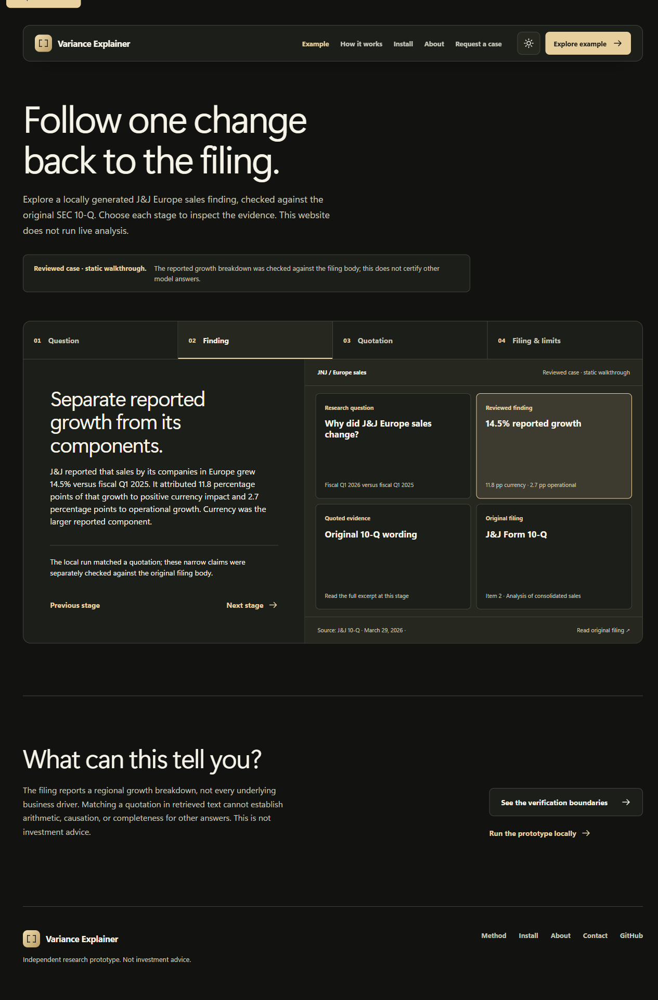
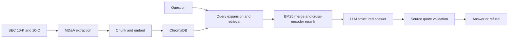

# RAG Variance Explainer

A SEC research workbench for investigating why a public company's financial metric changed, with inspectable quotations from 10-K and 10-Q filings. **Portfolio reviewers:** [explore the reviewed J&J case](https://rag-variance-explainer.vercel.app/example) in a browser. **Analysts and developers:** run the question-answering application locally. The public website is a **static walkthrough**, not a live model or question box. [Demo guide](DEMO.md) · [Evidence and limitations](docs/jnj-europe-sales-review-2026-11-11.md).



For the intended analyst decision workflow, planned news and private financial-PDF sources, and the evidence gates before publishing, see the [active product roadmap](docs/product-roadmap.md). Those extensions are **not** implemented by this local SEC prototype.

The local application is a research prototype, not investment advice. A source quote match confirms that the quoted text exists in a retrieved passage. It does not independently prove a causal explanation, a computed number, or investment suitability. Review the cited filing before relying on an answer.

**Portfolio demo work:** the J&J example received a separate claim-by-claim filing-body review and owner copy approval. The other [six candidate runs](docs/demo-review-results-2026-11-11.md) remain research observations, not approved public answers or a reliability metric. The case is a curated static walkthrough, not a hard-coded rule in the answer pipeline.

## Run locally

Use Python 3.11, enough disk space for model downloads and an index, and an internet connection to fetch SEC filings and embedding models. Set a descriptive `SEC_USER_AGENT` with your name and contact email. SEC requests fail with a clear error when it is missing. No prebuilt index is included, and no public inference service is provided.

Check `py -0p` on Windows before creating the environment. If the launcher does not list Python 3.11, install it or invoke its executable directly: `& "C:\path\to\Python311\python.exe" -m venv .venv`.

### Windows PowerShell

```powershell
py -3.11 -m venv .venv
.\.venv\Scripts\Activate.ps1
python -m pip install -e .
Copy-Item .env.example .env
```

### Linux and macOS

```bash
python3.11 -m venv .venv
source .venv/bin/activate
python -m pip install -e .
cp .env.example .env
```

Edit `.env` and set `SEC_USER_AGENT` to your name and contact email, for example `SEC_USER_AGENT=Jane Doe jane@example.com`. Choose one LLM backend:

- **Local:** Install `python -m pip install -e ".[local]"`, keep `LLM_BACKEND=llama_cpp`, download a compatible GGUF model, and set `LLAMA_CPP_MODEL_PATH` to its absolute path. CPU inference is the default (`LLAMA_CPP_N_GPU_LAYERS=0`, `LLAMA_CPP_N_BATCH=32`, `LLAMA_CPP_N_CTX=8192`). Only enable GPU layers after confirming a compatible GPU build and sufficient VRAM. The model is not included. On Windows, `llama-cpp-python` may need a compatible prebuilt wheel or a working C++ toolchain. If a model exists but fails to load, check available virtual memory and page-file capacity before downloading it again. Reduce `LLAMA_CPP_N_CTX` or `LLAMA_CPP_N_BATCH` when memory is tight.
- **Local Docker CUDA:** Run `llama-server` from `ghcr.io/ggml-org/llama.cpp:server-cuda` with GPU access and a GGUF bind-mounted read-only. Bind host port `127.0.0.1:8080` and confirm `http://127.0.0.1:8080/v1/models` responds. Install the OpenAI-compatible client with `python -m pip install -e ".[openai]"`, then set `LLM_BACKEND=llama_server`. The app uses the first loaded model returned by the server, or `LLAMA_SERVER_MODEL` if set. This backend sends passages only to the local server and does not load a second GGUF into the Streamlit process. The model server and app must each be started separately; a working server does not guarantee sufficient memory for retrieval or faithful answers.

  On Windows, with Docker Desktop running and the GGUF at `models/qwen2.5-7b-instruct-q4_k_m.gguf`, start the CUDA container from the repository root using `powershell -File .\scripts\run_local_llama.ps1`. Check readiness with `Invoke-RestMethod http://127.0.0.1:8080/v1/models`. Stop it with `docker stop rve-llama` when finished. The script requests 10 GPU layers, a batch of 32, and an 8192-token context for the 7B baseline; verify the effective context in server logs. The historical 35B benchmark used a different model and build; do not copy its `--n-cpu-moe` or TurboQuant flags into the official CUDA image.
- **OpenAI:** Install `python -m pip install -e ".[openai]"`, then set `LLM_BACKEND=openai` and `OPENAI_API_KEY`. This sends retrieved filing passages to the API and incurs API charges.
- **Anthropic:** Install `python -m pip install -e ".[anthropic]"`, then set `LLM_BACKEND=anthropic` and `ANTHROPIC_API_KEY`. This also sends retrieved passages to an external API.

The embedding and cross-encoder devices default to CPU. Set `EMBEDDING_DEVICE=cuda` and `RAG_CROSS_ENCODER_DEVICE=cuda` only when your PyTorch installation supports your NVIDIA GPU.

If you already have the working local Qwen3-8B CUDA container named `rve-official-8b-rag-34l`, use the [operator runbook](docs/demo-review-runbook.md) instead of the separate 7B launcher above. The container name and model ID in that runbook describe this operator's environment, not a downloadable part of this repository.

Build the index and start the UI from the repository root:

```bash
python src/build_index.py
streamlit run app.py
```

The first build downloads filings and models and may take substantial time. The builder records progress in `.build_checkpoint.json` and resumes after interruption. Use `python src/build_index.py --rebuild` to discard the checkpoint and reprocess the selected filings. Existing filings outside that selection remain in ChromaDB. The command exits with an error if any filing fails; rerun it after fixing the cause to resume from the checkpoint.

## Other local entry points

Start the REST API with `python -m uvicorn src.api:app --host 127.0.0.1 --port 8000`. Open `/docs` for its request schemas. Start the MCP server with `python src/server.py` in stdio mode. Configure your agent to run that command with this repository as its working directory and the same Python environment. See [MCP setup](docs/mcp.md) for tool details. Both entry points need the index and LLM setup above for generated answers.

## How an answer is produced



`src/build_index.py` owns indexing. `src/retrieval.py` and its search helpers own retrieval. `src/rag.py` orchestrates retrieval and generation. `src/verifier.py` parses structured answers and checks quote references. `app.py`, `src/api.py`, and `src/server.py` expose the same pipeline through UI, REST, and MCP.

See [architecture and failure behavior](docs/architecture.md) for the index update contract, data boundaries, and what quote validation can establish.

If structured output cannot be parsed or its quotes do not match the retrieved passages, the app refuses to present the model text as a sourced answer. Optional NLI verification is disabled by default (`RAG_NLI_ENABLED=false`) pending independent evaluation. The experimental execution of LLM-generated arithmetic code was removed from the application path.

When a Chat Completions response reports that its **output-token limit** was reached, Streamlit shows a warning instead of presenting incomplete JSON as a finding. The configured output ceiling is 4,096 tokens (`RAG_LLM_MAX_TOKENS`); this is an output cap, not a guarantee that it fits the server's context alongside the prompt. If the server reports a context-window error, reduce the limit or passages before retrying. See [the budget and SEC archive note](docs/output-budget-and-sec-archives.md). The app keeps only the latest answer in the current Streamlit session; it does not save a query history.

## Published research results

The earlier evaluation used 40 questions across seven companies. The reported full-pipeline retrieval recall@10 was **0.81** and mean reciprocal rank was **0.54**. The reported cross-sector answer faithfulness was **68.85% strict** and **79.51% weighted** after tuning. These are historical results from a particular index, model, configuration, and LLM-judge method. They have not been reproduced on the current working tree and do not measure production reliability. No fully human-labeled faithfulness set is available. See [dataset notes](docs/dataset.md) and [evaluation notes](docs/README.md) for methodology.

## Quality checks

Install development tools with `python -m pip install -e ".[dev]"`, then run `python -m pytest tests.py -q`. The GitHub Actions workflow also runs Ruff, mypy, Bandit, and a coverage gate. Unit tests mock LLM calls; passing them does not prove model accuracy or clean-install success. The code currently supports English SEC 10-K and 10-Q MD&A only. Cross-company comparisons and arithmetic questions need extra manual review. The application is local and single-user; it has no authentication or multi-tenant controls.

## Development status

The next release gate is a clean-clone setup on Windows and Linux, followed by a versioned evaluation with per-question results and human review of unsupported claims. Keep the package local until those gates pass. The agent skill in `.opencode/skills/rag-finance` currently assumes this repository's MCP server is already installed; it is not a standalone marketplace product.

The current app **does not accept uploaded PDFs**. See the [product roadmap](docs/product-roadmap.md) for the separate, unimplemented private-document workflow and security requirements. The website's J&J workpaper is a static reviewed example; it is not a hosted SEC question-answering service.

## License

MIT. See [LICENSE](LICENSE). Check the separate licenses and terms for any model or external service you choose.
